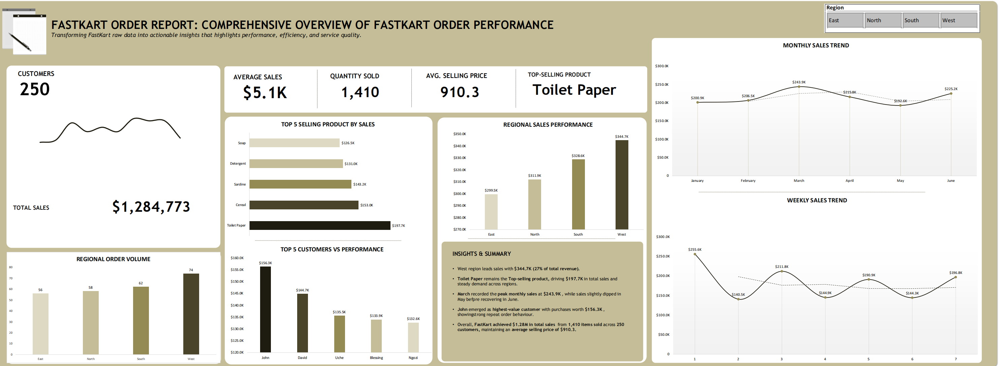

FastKart Sales Performance Analysis

Tools: Microsoft Excel, Power Query, Pivot Tables, Pivot Charts, Slicers

1. Business Problem

FastKart needed better visibility into its sales performance to understand revenue trends, identify its strongest and weakest-performing regions, evaluate product performance, and recognize its most valuable customers.

Without a consolidated view of these metrics, management would find it difficult to identify revenue opportunities, understand fluctuations in sales, and make informed decisions about product and regional performance.

The objective of this project was to transform raw sales records into an interactive analytical dashboard that provides actionable insights for business decision-making.

2. Business Questions

The analysis focused on answering the following questions:

- What is the overall revenue generated by the business?
- Which regions contribute the most and least to total revenue?
- Which products generate the highest revenue?
- How does revenue fluctuate across different months?
- Who are the highest-value customers?
- What is the average selling price per unit?

3. Tools and Technologies

- Microsoft Excel: Data analysis, calculations and dashboard development.
- Power Query: Data cleaning, transformation and preparation.
- Pivot Tables: Aggregating sales data across different business dimensions.
- Pivot Charts: Visualizing revenue trends and performance.
- Slicers: Enabling interactive filtering and exploration of business metrics.

4. Analytical Process

- Imported and prepared the raw sales dataset using Power Query.
- Cleaned and transformed the data to ensure consistency.
- Analyzed revenue distribution across regions, products, customers and months.
- Used Pivot Tables to calculate key performance indicators.
- Developed interactive visualizations to communicate sales performance.
- Created a dashboard with interactive filters for business exploration.

5. Key Performance Indicators

- Total Revenue
- Total Units Sold
- Total Customers
- Average Selling Price

6. Key Findings

The analysis revealed the following:

- Total Revenue: $1,284,773 generated from the sales records analyzed.
- Total Customers: 250 customers.
- Total Units Sold: 1,410 units.
- Average Selling Price: $911.19 per unit.
- Regional Performance: The West region generated the highest revenue at approximately $341,700, representing 27% of total revenue, while the East recorded the lowest at approximately $299,500.
- Product Performance: Toilet Paper emerged as the highest revenue-generating product, contributing approximately $197,700.
- Monthly Performance: March recorded the highest monthly revenue at approximately $243,900, while May recorded the lowest at approximately $192,800.
- Customer Performance: John emerged as the highest revenue-generating customer, contributing approximately $156,300.

7. Business Recommendations

- Investigate the factors driving the West region's stronger revenue performance and identify opportunities to replicate its success in other regions.
- Review the East region's sales performance to identify potential revenue gaps.
- Prioritize inventory planning for high-revenue products to maintain product availability.
- Investigate the decline in revenue observed in May compared with March.
- Examine purchasing patterns among high-value customers to identify opportunities for customer retention and increased sales.

8. Business Value

The project provides management with a consolidated view of sales performance, making it easier to monitor revenue trends, compare regional contributions, identify high-performing products and customers, and support data-driven commercial decisions.

